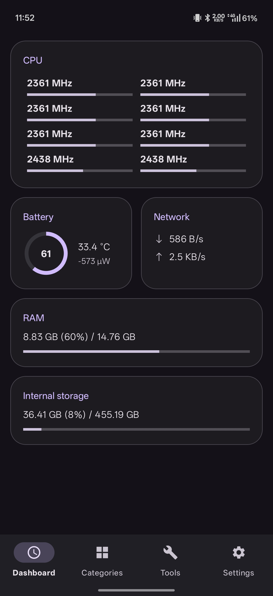
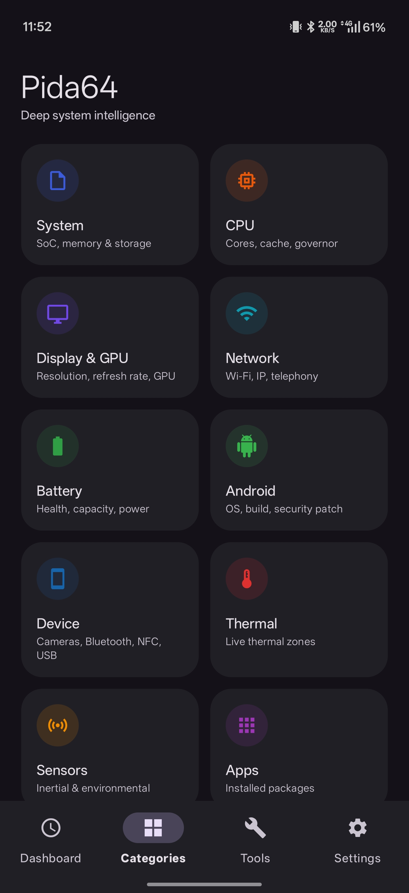
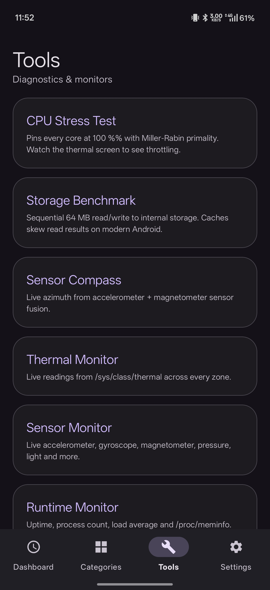
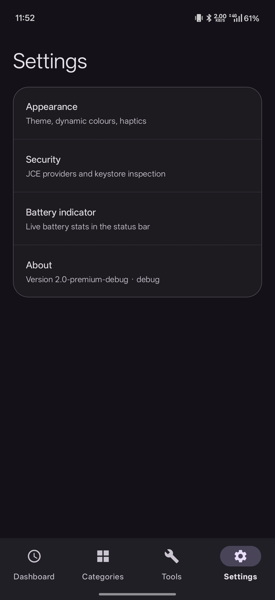

<p align="center">
  
</p>

<h1 align="center">Pida64</h1>
<p align="center"><b>Deep System Intelligence for Android</b></p>

<p align="center">
  
  
  
</p>

---

## Screenshots

<p align="center">
  
  
  
  
</p>

---

## About

**Pida64** is a premium hardware diagnostics app for Android. It is built from scratch as a privacy-first alternative to AIDA64, CPU-Z, and DevCheck.

**Zero trackers. Zero ads. Zero network calls. The `INTERNET` permission is not even declared.** Every byte of data stays on your device.

Built by **Undercover IT Firm**.

---

## Download

➡️ **[Download Latest APK from Releases](../../releases/latest)**

---

## Feature Overview

### 17 Deep Inspection Screens

| Category | What You See |
|---|---|
| **System** | SoC identification, memory & storage summary |
| **CPU** | Per-core live frequency, governor, cache topology, architecture, ABI, instruction sets |
| **Display & GPU** | Resolution, density, refresh rate, HDR, wide color gamut, cutout type |
| **Network** | Wi-Fi signal/frequency/band/capabilities, telephony operator/MCC/MNC, DHCP details |
| **Battery** | Level, health, temperature, voltage, current (µA precision), power (auto-scaled W/mW/µW), cycle count, design capacity, remaining time estimates |
| **Android** | OS version, API level, security patch, build fingerprint, GMS/Play Services/WebView versions |
| **Device** | Cameras, Bluetooth, NFC, USB, model, manufacturer, bootloader, baseband |
| **Thermal** | Live per-zone temperature from `/sys/class/thermal/` |
| **Sensors** | Complete sensor list with vendor, resolution, range, power consumption |
| **Apps** | All installed packages with version, target SDK, install date, APK size |
| **Codecs** | Hardware & software codec enumeration |
| **Storage** | Partition breakdown with used/free/total |
| **Directories** | Standard Android directory paths and sizes |
| **System Files** | Build.prop and key system properties |
| **Identifiers** | Android ID, Advertising ID, IMEI (where permitted), serial |
| **Runtime** | ART/Dalvik version, VM features, JIT status |
| **Security** | SELinux, encryption state, verified boot, keystore providers |

### Live Dashboard

Real-time monitoring on a single screen:

- **CPU** - per-core frequency with progress bars
- **Battery** - level ring, temperature, power draw (with charging context), current (µA precision), remaining time
- **Network** - live ↓/↑ throughput via TrafficStats
- **RAM** - used / total with percentage bar
- **Internal Storage** - used / total with percentage bar

### 7 Home-Screen Widgets

| Widget | Size | Update Cadence |
|---|---|---|
| Battery | 2×1 | 30 s |
| CPU | 2×1 | 2 s |
| RAM | 2×1 | 5 s |
| Storage | 2×1 | 60 s |
| Network (↓/↑) | 2×1 | 2 s |
| Thermal | 2×1 | 10 s |
| **Dashboard (all-in-one)** | **4×2** | **5 s** |

All 7 widgets share a **single AlarmManager wake-up**, so battery cost is constant regardless of how many you stack.

### Persistent Battery Indicator

Foreground-service notification with:

- Configurable 1–10 second refresh rate
- Multi-select title & description fields (checkboxes)
- Auto-dedup (same field never shown in both title and description)
- Sub-mA current display (µA when below 1 mA)
- Auto-scaling power (W → mW → µW)
- "to full" / "to empty" remaining time
- ⚡ Charging / idle / discharging context labels
- Silent, ongoing notifications have no badge and stay out of your way

### Diagnostic Tools

- **CPU Stress Test** - Pins every core at 100% using Miller-Rabin primality. Watch the thermal screen to observe throttling.
- **Storage Benchmark** - Sequential 64 MB read/write to internal storage with throughput measurement.
- **Sensor Compass** - Live azimuth from accelerometer + magnetometer fusion.
- **Thermal Monitor** - Live readings from every `/sys/class/thermal/` zone.
- **Sensor Monitor** - Live accelerometer, gyroscope, magnetometer, pressure, light, and more.
- **Runtime Monitor** - Uptime, process count, load average, `/proc/meminfo`.

---

## Technical Highlights

| Aspect | Detail |
|---|---|
| **Language** | Java 17 |
| **Min SDK** | 23 (Android 6.0 Marshmallow) |
| **Target SDK** | 35 (Android 15) |
| **UI Framework** | Material 3 (Material Design 3) |
| **Dependencies** | AndroidX + Material only: zero third-party SDKs |
| **Build System** | AGP 8.6.1 / Gradle 8.9 |
| **Code Shrinking** | R8 full mode with ProGuard rules |
| **Architecture** | Single-module, ViewBinding, edge-to-edge enforced |
| **Source Files** | 53 Java · 19 layouts · 32 drawables · 10 XML configs |
| **APK Size** | ~1.5 MB (release, R8-optimized) |

### Privacy Architecture

```
┌─────────────────────────────────────────────┐
│                  Pida64                       │
│                                               │
│  Reads: BatteryManager, /proc/stat,          │
│         ActivityManager, StatFs,              │
│         SensorManager, TelephonyManager,     │
│         /sys/class/thermal, TrafficStats,    │
│         Build.*, PackageManager              │
│                                               │
│  Writes: SharedPreferences (widget baselines)│
│                                               │
│  Network calls: ████████ ZERO ████████       │
│  Trackers:      ████████ ZERO ████████       │
│  Ads:           ████████ ZERO ████████       │
│                                               │
│  INTERNET permission: NOT DECLARED           │
└─────────────────────────────────────────────┘
```

### Permissions

| Permission | Why |
|---|---|
| `ACCESS_NETWORK_STATE` | Network connection info display |
| `ACCESS_WIFI_STATE` | Wi-Fi signal, frequency, band |
| `READ_PHONE_STATE` | Telephony properties |
| `READ_PHONE_NUMBERS` | Phone number in Identifiers |
| `AD_ID` | Advertising ID display |
| `BLUETOOTH` / `BLUETOOTH_CONNECT` | Bluetooth adapter info |
| `NFC` | NFC state display |
| `FOREGROUND_SERVICE` | Battery indicator notification |
| `POST_NOTIFICATIONS` | Notification on Android 13+ |

**Not declared:** `INTERNET`, `ACCESS_FINE_LOCATION`, `ACCESS_COARSE_LOCATION`

---

## Kernel Compatibility

Pida64 includes workarounds for known kernel-level bugs:

- **Sign-inverted `BATTERY_PROPERTY_CURRENT_NOW`** on Pixel 6/7/8/9 and Galaxy S22+: corrected using `EXTRA_PLUGGED` as authoritative charge direction source
- **Locked `/sys/class/thermal/`** on Pixel Android 14+: graceful fallback with "Restricted by Android" message
- **`/proc/net/dev` zeroed** on Android 11+ for third-party apps: switched to `TrafficStats` API
- **Redacted Wi-Fi SSID** on Android 12-16: SSID/BSSID removed from UI (Google framework bug affects all API paths including `FLAG_INCLUDE_LOCATION_INFO`)

---

## Support

💬 **Telegram:** [@UNDERCOVERITFIRM_GROUP](https://t.me/UNDERCOVERITFIRM_GROUP)

---

## License

Copyright © 2026 **Undercover IT Firm**. All rights reserved.

This software is proprietary. Source code is private. Unauthorized reverse engineering, decompilation, or redistribution is prohibited.
